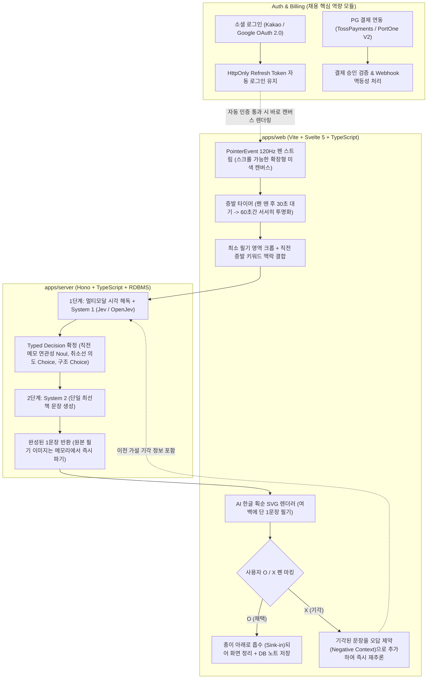

# 잇적 (It!note) — 상세 아키텍처 및 구현 계획서 (v4.0)

> [!IMPORTANT]
> **핵심 제품 철학 및 기술 원칙 (Product & Engineering Manifesto)**
> 1. **자동 로그인 후 Zero-UI 진입**: 최초 소셜 로그인(OAuth 2.0 + 장기 세션 자동 로그인) 및 온보딩 완료 후, 다음 접속부터는 로그인 창이나 헤더·푸터·설정·지우개 없이 즉시 미색 종이(`#FAF8F5`) 캔버스만 열립니다.
> 2. **여유 호흡의 증발 잉크 (30s Idle + 60s Fade)**: 단어나 도식을 적고 펜을 떼면 **30초간 그대로 유지**되어 다음 생각 연상을 돕고, 이후 **1분(60초) 동안 서서히 투명해지며 증발**합니다. 이미 증발한 뒤에 적힌 단어라도 직전 맥락과의 연속성을 끊지 않고 함께 추론합니다.
> 3. **단일 문장 대필 & 오답 학습 재추론 (Single Hypothesis & Iterative Refinement)**: AI는 여러 보기를 늘어놓지 않고 여백에 한글 획순으로 **단 1개의 추론 문장**만 적습니다. 맞으면 동그라미(`O`)를 쳐서 종이 아래로 흡수(Sink-in)시키고, 틀리면 엑스(`X`)를 쳐서 **"이전 가설이 틀렸음"을 반영한 더 정확한 문장을 즉시 다시 적게** 합니다.
> 4. **채용 핵심 역량 풀스택 내재화 (Svelte 5 + Hono + OAuth + PG 결제)**: 프론트-백엔드 단일 TypeScript 모노레포 위에서 **소셜 로그인(자동 로그인 토큰 로테이션)**과 **PG사 결제 연동(구독/크레딧 웹훅 검증 및 트랜잭션)**을 정식 구현합니다.

---

## 1. 시스템 아키텍처 (System Architecture)



---

## 2. 합의된 핵심 스펙 상세 (User-Aligned Specifications)

### 2.1. 소셜 로그인(자동 로그인) 및 PG사 결제 연동
채용 시장에서 가장 빈번하게 요구하는 인증·결제 아키텍처를 정석대로 구축합니다.
* **소셜 로그인 & Seamless Auto-Login**:
  * 카카오 / 구글 OAuth 2.0 로그인을 지원하며, 기본값으로 장기 로그인 유지(`HttpOnly, Secure` Refresh Token + Silent Refresh)를 활성화합니다.
  * 최초 1회 로그인 및 프로필/루틴 입력이 끝난 사용자는, 브라우저를 다시 켜면 로그인 페이지나 로딩 버튼 없이 **0.1초 만에 곧바로 백지 캔버스**만 마주하게 됩니다.
* **PG사 연동 (TossPayments 또는 PortOne)**:
  * 무료 일일 추론 크레딧 소진 시 또는 Pro 플랜 전환 시 작동하는 PG 결제 플로우를 구현합니다.
  * 단순 클라이언트 결제창 호출에 그치지 않고, **백엔드 결제 금액 위변조 검증, 비동기 Webhook 수신, 트랜잭션 멱등성(Idempotency) 보장**까지 구현하여 포트폴리오 핵심 어필 포인트로 삼습니다.

### 2.2. 캔버스 공간 및 증발 타이머 (30초 대기 + 60초 투명화)
* **적정 확장 스크롤 + 흡수(Sink-in) 결합**:
  * 동그라미(`O`)를 친 문장은 종이 속으로 스며들어 사라지므로 캔버스가 영구적으로 복잡해지지 않습니다.
  * 단, 기기 화면 크기 차이와 한 번에 여러 키워드/마인드맵을 넓게 적는 상황을 고려해, 끝없는 무한 캔버스 대신 **상하/좌우로 적당히 여유 있게 스크롤(두 손가락 패닝)할 수 있는 규격화된 노트 영역**을 제공합니다.
* **30초 + 60초 타이머와 증발 후 연속성 보장**:
  * 앞선 키워드를 보면서 다음 키워드를 떠올릴 수 있도록, 펜을 떼고 **30초 동안은 글씨가 진하게(`Opacity: 1.0`) 유지**됩니다.
  * 30초 뒤부터 **60초(1분) 동안 서서히 투명**해집니다.
  * **중요 (Post-Fade Continuity)**: 글씨가 완전히 투명해져 사라진 뒤에 새로 적은 키워드라 하더라도, 직전에 증발한 키워드와 무관하다고 단정하지 않습니다. `Jev`가 `[직전 증발 키워드/문장]`과 `[새 키워드]`의 의미적·시간적 거리를 계산(`Noul`)하여, 이어지는 생각이면 이전 문장을 보강/갱신합니다.

### 2.3. Jev 기반 '단일 문장' 추론 및 `X` 마킹 오답 노트 루프
* **한 번에 단 1문장만 필기**:
  * `Jev`가 사용자의 페르소나, 현재 요일/시간대 루틴 상태, 취소선(`THOUGHT_PIVOT`), 화살표 구조를 종합해 가장 확률 높은 방향 1가지를 결정하면, AI는 여백에 **가장 자연스러운 1문장**만 한글 획순으로 적습니다.
* **`X` 마킹을 통한 점진적 정답 수렴**:
  * 사용자가 그 문장에 `X`를 치면, 단순히 문장을 지우는 데 그치지 않고 `rejected_hypotheses: ["방금 기각된 문장 및 도메인"]`을 상태에 담아 즉시 재호출합니다.
  * AI는 *"아, 업무/코드리뷰 관련 메모가 아니라 사이드 프로젝트 아이디어였구나"*라고 오답을 배제하여 훨씬 정확한 새 문장을 다시 적어 내려갑니다.
* **"새 단어" vs "AI 문장에 대한 답장" 구분 인식 (핵심 피드백)**:
  * **대화 맥락**: "사용자 입력이 답장인지 새 단어인지는 판단하고 쓰게 해야지. 이후에 확장하기로 한 내용은 문장 위에 쓸 수 없는 구조인데..."
  * **기능 상세**: AI 문장 위가 아니라 문장 바깥 빈 여백에 사용자가 펜으로 글씨를 썼을 때, 이것이:
    1. AI 문장에 대한 **답장/보충 설명**인지 (예: "아니 DB 먼저", "Redis 추가해")
    2. 완전히 무관한 **새로운 독립 메모/키워드**인지
    AI가 위치(AI 문장과의 거리/배치)와 맥락을 비교해 판별하고, 답장이면 해당 피드백을 반영해 새 문장을 재작성하고, 새 단어면 기존 문장과 함께 복합 추론합니다.
* **직전 증발 키워드와의 맥락 연속성 (Noul 시간차 추론)**:
  * **대화 맥락**: 기획 헌법 제2조 & 3조
  * **기능 상세**: 이미 90초(30초 대기 + 60초 증발)가 지나 완전히 투명해져 증발한 키워드라도, 사용자가 몇 분 뒤 새 단어를 적었을 때 "이전 키워드와 연관된 흐름인가?"를 Jev가 함께 판별(`Noul`)하여 생각의 연속성을 복원하는 메모리 추론 체인을 구성합니다.

### 2.4. 간편한 온보딩·설정 분리 및 오작동 없는 워터마크 진입
* **캔버스(의도된 불편함)와 관리 화면(최대 편의성)의 철저한 분리**:
  * **캔버스 뷰 (`/`)**: 오직 스타일러스 손글씨만 허용되는 Zero-UI 영역입니다.
  * **관리/보관함 뷰 (`/desk`)**: 로그인, 상세 프로필 및 7일 시간표 드래그 설정, PG 결제, 흡수된 노트 검색/관리는 **일반적인 마우스·키보드·터치 버튼 UI**로 가장 편리하게 조작합니다.
* **손날(Palm) 오작동과 필기 침범을 막는 워터마크 진입 규칙**:
  * 오른손/왼손 손날이 모서리에 닿아 더블탭으로 오인식되는 현상을 막기 위해, 워터마크 트리거는 **`pointerType === 'pen'`(스타일러스 펜촉)** 입력만 인정합니다.
  * 일반 필기 중 모서리를 스치는 획과 구분되도록, `잇적` 워터마크 위를 **펜촉으로 더블탭 후 0.8초 홀드(또는 전용 제스처)**할 때만 보관함(`/desk`)이 열립니다.

### 2.5. 휘발되지 않는 '본인 정보 맥락 진화 (Progressive Profile Enrichment)'
사용자가 초기에 입력한 얇은 프로필(직무, 관심사 몇 단어)이 고정된 채로 머물거나 이전 메모 맥락이 휘발되는 문제를 해결합니다.

* **왜 `X`(기각)가 아닌 `O`(확정) 데이터로만 맥락을 누적하는가? (트레이드오프 방어)**:
  * `X`를 친 문장은 '주제가 틀렸는지', '단어 오인식인지', '문체가 싫은지' 원인이 불명확하므로 장기 프로필에 반영하면 맥락이 오염됩니다 (`X`는 당장의 재추론 시 오답 배제용으로만 사용).
  * 반면 사용자가 **`O`를 쳐서 흡수시킨 문장은 100% 본인의 생각으로 검증된 사실(Ground Truth)**입니다.
* **2계층 맥락 보존 메커니즘 (휘발 0%)**:
  1. **고정/반고정 코어 프로필 (Base Persona & 7-Day Routine)**: 사용자가 직접 입력한 나이, 성별, 직무, 요일별 시간표.
  2. **자동 누적되는 동적 맥락 트리 (`Evolving Context Graph` — DB JSONB 영구 누적)**:
     * 사용자가 문장에 `O`를 칠 때마다 해당 문장이 그냥 보관함으로만 사라지지 않고, 문장 속 **핵심 주제·진행 중인 작업·고민 키워드**가 사용자 정보의 하위 슬롯(`ongoing_topics`, `domain_vocabulary`, `confirmed_preferences`)에 누적 병합됩니다.
     * **예시**: 초기 입력이 `"DevSecOps 취준생"`뿐이었더라도, 메모가 쌓이면 본인 정보 맥락에 `"현재 진행 중인 관심사: Svelte 5 + Hono 모노레포 기반 '잇적' 앱 개발, Jev 의사결정 모델 연동, gitleaks 하드가드 구축"`이 자동으로 축적되어, 한 달 뒤에 단어 두 개만 적어도 이 누적된 본인 맥락 위에서 정확히 추론합니다.
  3. **직전 확정 문장 레퍼런스 (Recent 5-10 Confirmed Notes)**: 사용자의 선호 문장 호흡과 어투를 유지하기 위해 가장 최근 `O`를 친 문장 원문 5-10개를 함께 주입합니다.

### 2.6. [ADR / v2 백로그] 온디바이스 손글씨 OCR 및 SemIf-OpenJev 3-Tier 파이프라인
* **논의 배경 (Context & Motivation)**:
  * 경량 한국어 손글씨 OCR 모델(`VerifiedIdiot/korean-handwriting-rec` PP-OCRv5 ONNX ~15MB) 및 로짓 판별 엔진(`TheoLeeCJ/SemIf-OpenJev`)의 발굴.
  * 픽셀 이미지를 외부 클라우드 VLM에 통째로 전송하는 기존 방식 대비, [로컬 OCR $\to$ 로컬 SemIf $\to$ 클라우드 LLM 윤문]으로 분리하면:
    1. **토큰 및 비용 90% 이상 절감**: 멀티모달 이미지 토큰(258~1,000+ 토큰) $\to$ 순수 텍스트 JSON 토큰(30~50 토큰). 페이로드 크기 역시 수십 KB Base64에서 수백 바이트로 축소.
    2. **완전한 Zero-Outbound 기밀성 (DevSecOps)**: 사용자의 실제 손글씨 필적과 래스터 픽셀이 외부 네트워크로 단 1바이트도 나가지 않고 로컬에서 파기됨.
    3. **구조화된 입력 $\to$ 구조화된 출력 (Structured In $\to$ Structured Out)**: `SemIf-OpenJev`가 Qwen-1.5B 가중치에서 1회 포워드 패스 로짓 판독(Logit Readout, 30ms CPU)으로 `Noul`과 `Choice`를 확정하고, LLM에게 기호적 관계(Symbolic Relation)를 명시 주입하여 환각 없는 정확한 가설을 생성.
* **SemIf 도입 시점 정의 (로컬 OCR과 동시 도입 필수 원칙)**:
  * **왜 SemIf를 지금 단독 도입하지 않는가?**: `SemIf-OpenJev`는 텍스트 기호를 입력받아 선택지 로짓을 읽는 모델이며, 이미지 픽셀을 직접 읽지 못합니다. 로컬 OCR이 없다면 결국 클라우드 VLM이 이미지를 읽어야 하므로 SemIf 단독 도입은 모순이 발생합니다.
  * **결론**: **로컬 손글씨 OCR 모델(Tier 2A)과 SemIf-OpenJev 로짓 엔진(Tier 2B)은 한 쌍의 원자적 패키지로 함께 도입**되어야만 성립합니다.
* **잠재적 위험 및 기술적 과제 (Risks & Red Teaming)**:
  1. **텍스트 영역 탐지(Text Detection)의 부재**: 공개된 경량 모델들은 잘라낸 1줄 단어를 읽는 Recognizer이므로, 2400×1800 캔버스에서 단어 단위 Bounding Box를 분할하고 화살표/취소선 벡터와 글자 획을 분리하는 클러스터링(DBSCAN / DBNet) 전처리 파이프라인 구축 공수 발생.
  2. **연쇄 오차 전파 (Cascading Error)**: 앞단 로컬 OCR의 문자 왜곡이 심할 경우, 정형 JSON에 고정되어 뒤쪽 LLM으로 전파될 위험.
  3. **네이티브 C++ 바인딩(`onnxruntime-node`, `llama.cpp`) 배포 위험**: Windows 개발 환경과 최종 Linux Docker 배포 환경 간의 `node-gyp`, `glibc`, 아키텍처 의존성 충돌 위험.
* **마일스톤 2.5를 신설하지 않고 v2 백로그로 격리한 이유 (Decision Rationale)**:
  * **핵심 비즈니스 검증 보호**: 채용 시장에서 가장 중요하게 검증되는 마일스톤 3 (카카오/구글 OAuth 소셜 로그인, 7일 드래그 온보딩, PG사 결제 승인/웹훅 멱등성, 단일 Dockerfile 배포)의 일정을 사수해야 함.
  * **조기 최적화(Premature Optimization) 방지 (Ponytail 원칙)**: 현재 `gemini-3.8-flash` VLM이 단 1회 호출로 이미지, 화살표, 취소선, 문맥을 올인원으로 처리하고 있으므로, 3-Tier 로컬 모델 전환은 실제 트래픽과 API 비용이 병목이 되는 시점에 최우선 과제로 추진.

---

## 3. 모노레포 디렉토리 구조 (Monorepo Structure)

```text
c:/work/it!note/
├── .githooks/
│   └── pre-commit                  # Gitleaks + Zero-UI + 파일 10개 제한 하드가드
├── .gitleaks.toml                  # Jev / Gemini / OAuth / PG Secret Key 스캔 설정
├── AGENTS.md                       # AI 에이전트 아키텍처 헌법 (Soft Guard)
├── PLAN.md                         # 프로젝트 상세 아키텍처 및 구현 계획서
├── packages/
│   └── shared/                     # 프론트-백엔드 공통 타입 및 Jev 스키마
│       └── src/
│           ├── jev.ts              # Noul, Choice, Score, Box 타입 및 의사결정 인터페이스
│           ├── auth.ts             # User, EvolvingProfile, RoutineMatrix, Subscription 타입
│           └── note.ts             # Stroke, InkCluster, Hypothesis, RejectedContext 타입
├── apps/
│   ├── web/                        # Frontend (Vite + Svelte 5 + TypeScript)
│   │   └── src/
│   │       ├── lib/
│   │       │   ├── canvas/         # [Zero-UI 구역] 일반 UI 태그 절대 금지
│   │       │   │   ├── PaperCanvas.svelte      # 미색 종이, 여유 스크롤, 30s+60s 증발 엔진
│   │       │   │   ├── AiHandwriting.svelte    # 한글 자소 분해 & 획순 SVG 단일 문장 렌더러
│   │       │   │   ├── OxGestureLayer.svelte   # O(흡수 저장) / X(오답 반영 재추론) 제스처 감지
│   │       │   │   └── hangulStrokeEngine.ts   # 초·중·종성 분해 및 벡터 Path 계산기
│   │       │   ├── auth/
│   │       │   │   └── LoginView.svelte        # 소셜 로그인 & 자동 로그인 설정 화면
│   │       │   ├── onboarding/
│   │       │   │   ├── ProfileSetup.svelte     # 상세 페르소나 입력 (직무, 나이, 성별, 관심사)
│   │       │   │   └── RoutineMatrix.svelte    # 7일 요일별 드래그 타임블록 설정
│   │       │   ├── billing/
│   │       │   │   └── PaymentModal.svelte     # PG사 정기구독/후원 결제창 연동
│   │       │   └── archive/
│   │       │       └── DeskView.svelte         # 흡수된 노트 보관함 & 진화된 내 맥락 확인/편집
│   │       └── App.svelte
│   └── server/                     # Backend (Hono + TypeScript + DB)
│       └── src/
│           ├── index.ts            # Hono 서버 엔트리
│           ├── routes/
│           │   ├── auth.ts         # OAuth 2.0 콜백 및 JWT/Session 자동 갱신
│           │   ├── billing.ts      # PG사 결제 승인 검증 및 Webhook 멱등성 처리
│           │   └── infer.ts        # Jev + VLM 추론 및 O 확정 시 프로필 맥락 누적 라우트
│           └── services/
│               ├── system1Jev.ts   # Jev / OpenJev (/v1/systemone) 의사결정 엔진
│               ├── system2Writer.ts# 단일 가설 문장 생성기
│               └── profileEnricher.ts # O 확정 노트를 사용자 본인 정보 맥락에 병합하는 누적기
├── Dockerfile                      # 단일 컨테이너 배포 이미지
└── package.json                    # Workspace 루트 설정
```

---

## 4. 단계별 구현 로드맵 (MVP 1차 vs v2 확장 분리)

### [MVP 1차 목표 — 핵심 완성도 집중]
* **Phase 1: TypeScript 모노레포(`Svelte 5` + `Hono`) 및 `packages/shared` 스키마 구축**
* **Phase 2: 소셜 로그인(자동 로그인 유지), 온보딩(페르소나 + 7일 드래그 시간표), PG 결제(테스트/빌링 웹훅 검증) 모듈 구현**
* **Phase 3: `apps/web` Zero-UI 캔버스(30초 대기 + 1분 증발, 여유 스크롤) 및 한글 획순 단일 문장 대필 + O/X 인터랙션 구현**
* **Phase 4: `apps/server` Dual-Process (`Jev` + `VLM`) 추론 엔진 + `O` 확정 기반 본인 맥락 누적기(`profileEnricher.ts`) 연동 및 컨테이너 패키징**

### [v2 확장 백로그 및 고도화 — 마일스톤 4]
* **마일스톤 4: 텍스트 기반 맥락 추론 특화 온디바이스 SLM (LoRA + INT4 ONNX) 파이프라인**
  - **아키텍처 역할 분리**: 비전 OCR(필기->단어열)과 맥락 추론(단어열->Jev 의사결정)을 엄격히 격리.
  - **특화 SLM 선정**: `Qwen2.5-0.5B / 1.5B-Instruct` 또는 `Gemma-2-2B-IT`.
  - **합성 데이터셋 및 LoRA 파인튜닝**: Gemini 교사 모델로 구축한 1만 건의 `[단어열 + 직전 맥락 -> Jev JSON 프리미티브]` 데이터셋으로 LoRA 학습.
  - **온디바이스 서빙 (ONNX / WebAssembly)**: INT4 양자화를 통해 모델 크기 400MB 이하, 로컬 CPU 레이턴시 50ms 이내 서빙 달성.
  - **효과**: 프라이버시 100% 보장(Zero-Retention), 외부 API 호출 비용 0원, AI 엔지니어링 포트폴리오(Teacher-Student LoRA + Quantization) 확립.
* Notion OAuth 데이터베이스 자동 푸시 및 Slack Webhook 연동
* Pro 구독자 전용 심화 기능 확장 (장기 아카이브 시맨틱 검색 등)
