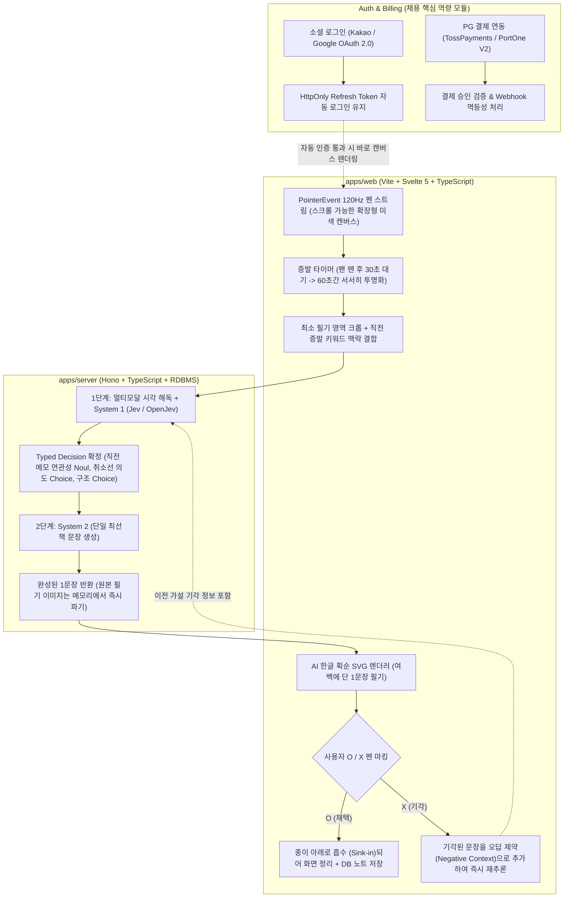
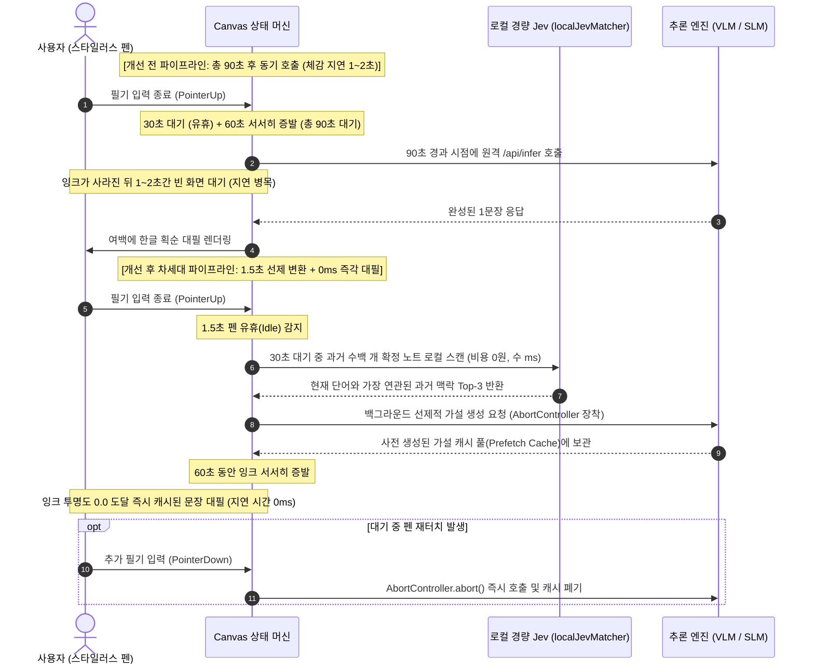
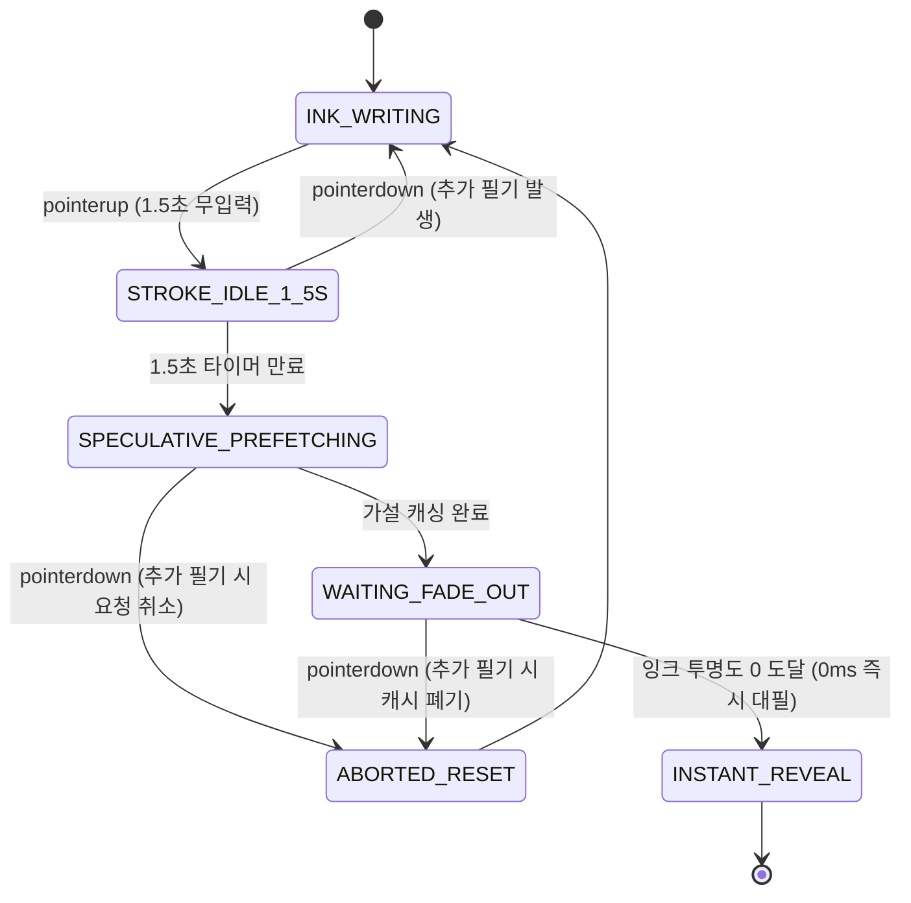
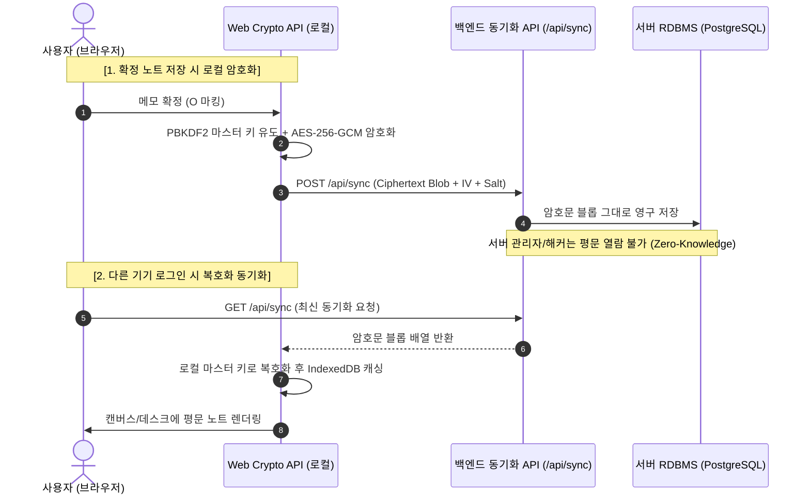

# 잇적 (It!note) — 상세 아키텍처 및 구현 계획서 (v4.0)

> [!IMPORTANT]
> **핵심 제품 철학 및 기술 원칙 (Product & Engineering Manifesto)**
> 1. **자동 로그인 후 Zero-UI 진입**: 최초 소셜 로그인(OAuth 2.0 + 장기 세션 자동 로그인) 및 온보딩 완료 후, 다음 접속부터는 로그인 창이나 헤더·푸터·설정·지우개 없이 즉시 미색 종이(`#FAF8F5`) 캔버스만 열립니다.
> 2. **여유 호흡의 증발 잉크 (30s Idle + 60s Fade)**: 단어나 도식을 적고 펜을 떼면 **30초간 그대로 유지**되어 다음 생각 연상을 돕고, 이후 **1분(60초) 동안 서서히 투명해지며 증발**합니다. 이미 증발한 뒤에 적힌 단어라도 직전 맥락과의 연속성을 끊지 않고 함께 추론합니다.
> 3. **단일 문장 대필 & 오답 학습 재추론 (Single Hypothesis & Iterative Refinement)**: AI는 여러 보기를 늘어놓지 않고 여백에 한글 획순으로 **단 1개의 추론 문장**만 적습니다. 맞으면 동그라미(`O`)를 쳐서 종이 아래로 흡수(Sink-in)시키고, 틀리면 엑스(`X`)를 쳐서 **"이전 가설이 틀렸음"을 반영한 더 정확한 문장을 즉시 다시 적게** 합니다.
> 4. **채용 핵심 역량 풀스택 내재화 (Svelte 5 + Hono + OAuth + PG 결제)**: 프론트-백엔드 단일 TypeScript 모노레포 위에서 **소셜 로그인(자동 로그인 토큰 로테이션)**과 **PG사 결제 연동(구독/크레딧 웹훅 검증 및 트랜잭션)**을 정식 구현합니다.

---

## 1. 시스템 아키텍처 (System Architecture)



---

## 2. 합의된 핵심 스펙 상세 (User-Aligned Specifications)

### 2.1. 소셜 로그인(자동 로그인) 및 PG사 결제 연동
채용 시장에서 가장 빈번하게 요구하는 인증·결제 아키텍처를 정석대로 구축합니다.
* **소셜 로그인 & Seamless Auto-Login**:
  * 카카오 / 구글 OAuth 2.0 로그인을 지원하며, 기본값으로 장기 로그인 유지(`HttpOnly, Secure` Refresh Token + Silent Refresh)를 활성화합니다.
  * 최초 1회 로그인 및 프로필/루틴 입력이 끝난 사용자는, 브라우저를 다시 켜면 로그인 페이지나 로딩 버튼 없이 **0.1초 만에 곧바로 백지 캔버스**만 마주하게 됩니다.
* **PG사 연동 (TossPayments 또는 PortOne)**:
  * 무료 일일 추론 크레딧 소진 시 또는 Pro 플랜 전환 시 작동하는 PG 결제 플로우를 구현합니다.
  * 단순 클라이언트 결제창 호출에 그치지 않고, **백엔드 결제 금액 위변조 검증, 비동기 Webhook 수신, 트랜잭션 멱등성(Idempotency) 보장**까지 구현하여 포트폴리오 핵심 어필 포인트로 삼습니다.

### 2.2. 캔버스 공간 및 증발 타이머 (30초 대기 + 60초 투명화)
* **적정 확장 스크롤 + 흡수(Sink-in) 결합**:
  * 동그라미(`O`)를 친 문장은 종이 속으로 스며들어 사라지므로 캔버스가 영구적으로 복잡해지지 않습니다.
  * 단, 기기 화면 크기 차이와 한 번에 여러 키워드/마인드맵을 넓게 적는 상황을 고려해, 끝없는 무한 캔버스 대신 **상하/좌우로 적당히 여유 있게 스크롤(두 손가락 패닝)할 수 있는 규격화된 노트 영역**을 제공합니다.
* **30초 + 60초 타이머와 증발 후 연속성 보장**:
  * 앞선 키워드를 보면서 다음 키워드를 떠올릴 수 있도록, 펜을 떼고 **30초 동안은 글씨가 진하게(`Opacity: 1.0`) 유지**됩니다.
  * 30초 뒤부터 **60초(1분) 동안 서서히 투명**해집니다.
  * **중요 (Post-Fade Continuity)**: 글씨가 완전히 투명해져 사라진 뒤에 새로 적은 키워드라 하더라도, 직전에 증발한 키워드와 무관하다고 단정하지 않습니다. `Jev`가 `[직전 증발 키워드/문장]`과 `[새 키워드]`의 의미적·시간적 거리를 계산(`Noul`)하여, 이어지는 생각이면 이전 문장을 보강/갱신합니다.

### 2.3. Jev 기반 '단일 문장' 추론 및 `X` 마킹 오답 노트 루프
* **한 번에 단 1문장만 필기**:
  * `Jev`가 사용자의 페르소나, 현재 요일/시간대 루틴 상태, 취소선(`THOUGHT_PIVOT`), 화살표 구조를 종합해 가장 확률 높은 방향 1가지를 결정하면, AI는 여백에 **가장 자연스러운 1문장**만 한글 획순으로 적습니다.
* **`X` 마킹을 통한 점진적 정답 수렴**:
  * 사용자가 그 문장에 `X`를 치면, 단순히 문장을 지우는 데 그치지 않고 `rejected_hypotheses: ["방금 기각된 문장 및 도메인"]`을 상태에 담아 즉시 재호출합니다.
  * AI는 *"아, 업무/코드리뷰 관련 메모가 아니라 사이드 프로젝트 아이디어였구나"*라고 오답을 배제하여 훨씬 정확한 새 문장을 다시 적어 내려갑니다.
* **"새 단어" vs "AI 문장에 대한 답장" 구분 인식 (핵심 피드백)**:
  * **대화 맥락**: "사용자 입력이 답장인지 새 단어인지는 판단하고 쓰게 해야지. 이후에 확장하기로 한 내용은 문장 위에 쓸 수 없는 구조인데..."
  * **기능 상세**: AI 문장 위가 아니라 문장 바깥 빈 여백에 사용자가 펜으로 글씨를 썼을 때, 이것이:
    1. AI 문장에 대한 **답장/보충 설명**인지 (예: "아니 DB 먼저", "Redis 추가해")
    2. 완전히 무관한 **새로운 독립 메모/키워드**인지
    AI가 위치(AI 문장과의 거리/배치)와 맥락을 비교해 판별하고, 답장이면 해당 피드백을 반영해 새 문장을 재작성하고, 새 단어면 기존 문장과 함께 복합 추론합니다.
* **직전 증발 키워드와의 맥락 연속성 (Noul 시간차 추론)**:
  * **대화 맥락**: 기획 헌법 제2조 & 3조
  * **기능 상세**: 이미 90초(30초 대기 + 60초 증발)가 지나 완전히 투명해져 증발한 키워드라도, 사용자가 몇 분 뒤 새 단어를 적었을 때 "이전 키워드와 연관된 흐름인가?"를 Jev가 함께 판별(`Noul`)하여 생각의 연속성을 복원하는 메모리 추론 체인을 구성합니다.

### 2.4. 간편한 온보딩·설정 분리 및 오작동 없는 워터마크 진입
* **캔버스(의도된 불편함)와 관리 화면(최대 편의성)의 철저한 분리**:
  * **캔버스 뷰 (`/`)**: 오직 스타일러스 손글씨만 허용되는 Zero-UI 영역입니다.
  * **관리/보관함 뷰 (`/desk`)**: 로그인, 상세 프로필 및 7일 시간표 드래그 설정, PG 결제, 흡수된 노트 검색/관리는 **일반적인 마우스·키보드·터치 버튼 UI**로 가장 편리하게 조작합니다.
* **손날(Palm) 오작동과 필기 침범을 막는 워터마크 진입 규칙**:
  * 오른손/왼손 손날이 모서리에 닿아 더블탭으로 오인식되는 현상을 막기 위해, 워터마크 트리거는 **`pointerType === 'pen'`(스타일러스 펜촉)** 입력만 인정합니다.
  * 일반 필기 중 모서리를 스치는 획과 구분되도록, `잇적` 워터마크 위를 **펜촉으로 더블탭 후 0.8초 홀드(또는 전용 제스처)**할 때만 보관함(`/desk`)이 열립니다.

### 2.5. 휘발되지 않는 '본인 정보 맥락 진화 (Progressive Profile Enrichment)'
사용자가 초기에 입력한 얇은 프로필(직무, 관심사 몇 단어)이 고정된 채로 머물거나 이전 메모 맥락이 휘발되는 문제를 해결합니다.

* **왜 `X`(기각)가 아닌 `O`(확정) 데이터로만 맥락을 누적하는가? (트레이드오프 방어)**:
  * `X`를 친 문장은 '주제가 틀렸는지', '단어 오인식인지', '문체가 싫은지' 원인이 불명확하므로 장기 프로필에 반영하면 맥락이 오염됩니다 (`X`는 당장의 재추론 시 오답 배제용으로만 사용).
  * 반면 사용자가 **`O`를 쳐서 흡수시킨 문장은 100% 본인의 생각으로 검증된 사실(Ground Truth)**입니다.
* **2계층 맥락 보존 메커니즘 (휘발 0%)**:
  1. **고정/반고정 코어 프로필 (Base Persona & 7-Day Routine)**: 사용자가 직접 입력한 나이, 성별, 직무, 요일별 시간표.
  2. **자동 누적되는 동적 맥락 트리 (`Evolving Context Graph` — DB JSONB 영구 누적)**:
     * 사용자가 문장에 `O`를 칠 때마다 해당 문장이 그냥 보관함으로만 사라지지 않고, 문장 속 **핵심 주제·진행 중인 작업·고민 키워드**가 사용자 정보의 하위 슬롯(`ongoing_topics`, `domain_vocabulary`, `confirmed_preferences`)에 누적 병합됩니다.
     * **예시**: 초기 입력이 `"DevSecOps 취준생"`뿐이었더라도, 메모가 쌓이면 본인 정보 맥락에 `"현재 진행 중인 관심사: Svelte 5 + Hono 모노레포 기반 '잇적' 앱 개발, Jev 의사결정 모델 연동, gitleaks 하드가드 구축"`이 자동으로 축적되어, 한 달 뒤에 단어 두 개만 적어도 이 누적된 본인 맥락 위에서 정확히 추론합니다.
  3. **직전 확정 문장 레퍼런스 (Recent 5-10 Confirmed Notes)**: 사용자의 선호 문장 호흡과 어투를 유지하기 위해 가장 최근 `O`를 친 문장 원문 5-10개를 함께 주입합니다.

### 2.6. [ADR 개정] Python 네이티브 손글씨 OCR(`jysvai/ko-hand-ocr`) + Google `gemini-decision-1` 파이프라인
* **논의 배경 (Context & Motivation)**:
  * 기존 v2 계획의 `VerifiedIdiot/korean-handwriting-rec` ONNX 및 `klue/roberta-large` (`onnxruntime-node`) 구상을 폐기하고, 한국어 손글씨 인식 정확도와 운영 단순성을 동시에 달성하는 구조로 전환합니다.
  * `jysvai/ko-hand-ocr`은 PyTorch 기반 Python 패키지(`kohandocr`)이므로, ONNX 변환 시 자모 디코딩 및 줄 분할 성능 저하 위험을 피하기 위해 Python 네이티브 HTTP 사이드카(`services/ocr/`, `OCR_ENDPOINT_URL`) 예외를 허용합니다.
  * 단, `ko-hand-ocr`은 순수 문자 인식에 특화되어 취소선·화살표·동그라미 같은 시각 기호를 판별할 수 없으므로, 시각 기호 분류와 5-Way 후보 채점은 멀티모달 네이티브 System 1 모델인 Google **`gemini-decision-1`** (Decisions API)에 일임합니다.
* **아키텍처 역할 분담 (4-Step Separation)**:
  1. **로컬 OCR (`services/ocr/` — `jysvai/ko-hand-ocr`)**: 필기 영역 이미지에서 한국어 텍스트만 고정밀 추출(`OCR_ENDPOINT_URL` 미설정 시 Gemini 멀티모달 OCR로 폴백).
  2. **기하학 좌표 고정 (`marginBox`)**: 여백 대필 좌표는 AI 모델 추론을 배제하고 `strokeMetadata.bbox`와 뷰포트 기준 수학 수식으로 결정론적 산출.
  3. **System 2 (`gemini-4-hydrogen` / `gemini-flash`)**: OCR 텍스트·System 1 판별 결과·장기 맥락을 결합해 5개 직교 후보 문장(`candidatePool`) 생성.
  4. **System 1 (`gemini-decision-1` Decisions API)**: 시각 기호(`strikethroughIntent`, `visualStructure`, `inputClassification`, `isContinuousWithPrevious`) 판별 및 5개 후보 각각의 독립 점수/확률(`candidateScores`, `0.00-1.00`) 산출.
* **`X` 기각 시 동적 임계치(`reuseThreshold`) 기반 차순위 재사용**:
  * 사용자가 1위 문장에 `X`를 쳐서 기각할 때, 미기각 잔여 후보 중 최고 점수가 `reuseThreshold`(기본값 `0.60`, 개발자 테스트 뷰 및 쿼리로 실시간 조정 가능) 이상이면 추가 추론 API 호출 없이 `0ms` 즉시 차순위 후보를 대필합니다.
  * 잔여 후보 점수가 모두 `reuseThreshold` 미만이거나 풀을 소진한 경우에만 `rejectedHypotheses`를 제약 조건으로 주입해 System 2 5개 후보를 재생성합니다.

### 2.7. [ADR / v2 백로그] 선제적 투기적 추론(Speculative Pre-Inference) 및 로컬 Jev 장기 맥락 자연어 검색
* **논의 배경 (Context & Motivation)**:
  * 현행 파이프라인(`canvasLifecycle.ts`)은 사용자가 필기를 멈추고 **30초 대기 + 60초 증발이 완전히 끝난 90초 시점**에야 비로소 `/api/infer`를 호출합니다.
  * 이로 인해 잉크가 완전히 사라진 뒤 사용자가 1~2초간 빈 화면을 대기해야 하는 반응성 지연이 발생합니다.
  * 또한 현재 맥락 주입 방식은 최근 확정 노트 5개만 FIFO로 잘라 보내므로, 과거의 중요한 연관 노트 맥락이 유실되는 한계가 존재합니다.



* **아키텍처 결정 사항 (Architecture Decisions)**:
  1. **선제적 투기적 변환 (Speculative Pre-Conversion & Pre-Inference)**:
     * 사용자가 펜을 뗀 뒤 **1.5초 동안 추가 입력이 없으면(Stroke Idle)**, 잉크가 유지되고 증발하는 30~90초 대기 시간 동안 백그라운드에서 필기 인식(OCR)과 Jev 가설 생성을 미리 수행하여 클라이언트 캐시에 보관합니다.
     * 잉크 투명도가 0이 되는 순간 네트워크 대기 없이 **지연 시간 0ms로 즉시 완성된 가설 문장을 대필**합니다.
     * 대기 중 사용자가 캔버스에 펜을 다시 대면 이전 투기적 실행을 `AbortController`로 즉시 취소하고 캐시를 무효화하여 불필요한 연산을 방어합니다.
  2. **로컬 경량 Jev(`localJevMatcher`) 기반 장기 맥락 자연어 검색**:
     * PostgreSQL 기반의 Jev 임베딩/의사결정 확장기(`realZachi/pg-jev`)를 클라우드 API가 아닌 **로컬 경량 Jev 인스턴스(IPC 또는 루프백 바인딩)**와 결합합니다.
     * 30초 펜 유휴 시간 동안 과거 수백 개의 확정 노트를 대상으로 자연어 조건/의미적 유사도(`pg-jev`의 Jev 의사결정 조건문)를 로컬에서 초고속(수 ms)으로 질의합니다.
     * 외부 API 호출 비용과 190ms 네트워크 왕복 지연 없이, "오늘 작성 중인 메모와 의미적으로 가장 밀접한 과거 맥락 Top-3"을 동적으로 추출하여 가설 생성기에 주입합니다.
  3. **Google System 1 (`gemini-decision-1` Decisions API) 기반 멀티모달 판별 및 5-Way 리랭킹**:
     * 기존 `klue/roberta-large` INT8 ONNX(`onnxruntime-node`) 계획을 폐기하고 Google **`gemini-decision-1`** Decisions API를 채택합니다.
     * 출력 토큰이 0개인 비자기회귀 판별 모델을 통해 필기 이미지의 시각 기호 분류와 System 2 5개 후보 문장의 독립 Rubric Score(`0.00-1.00`)를 단일 패스(150-250ms)로 산출합니다.
     * 가중치 330MB 다운로드, 커스텀 WordPiece 토크나이저, C++ 네이티브 바인딩 배포 리스크를 전면 제거합니다.
* **트레이드오프 및 리스크 분석 (Trade-offs & Red Teaming)**:
  * **불필요한 연산 낭비 위험**: 1.5초마다 투기적 실행을 돌릴 경우, 사용자가 생각을 가다듬으며 펜을 여러 번 뗐다 붙일 때 중복 연산 비용이 발생할 수 있습니다.
    * *완화책*: 로컬 경량 모델 도입 전까지는 클라우드 VLM 호출에 5~10초 Debounce 윈도우를 적용하고, 펜이 다시 닿으면 즉시 요청 취소(`req.signal.aborted`)를 처리합니다.
  * **로컬 pg-jev 서빙 복잡도**: 클라이언트 기기나 로컬 백엔드에 PostgreSQL 엔진과 pg-jev 확장을 상시 구동하는 것은 경량 모노레포에 부담이 될 수 있습니다.
    * *완화책*: SQLite 가상 테이블 확장 또는 인메모리 임베딩 인덱스(HNSW)에 Jev 평가기를 바인딩하는 경량 로컬 저장소를 우선 검토합니다.

---

## 3. 모노레포 디렉토리 구조 (Monorepo Structure)

```text
c:/work/it!note/
├── .githooks/
│   └── pre-commit                  # Gitleaks + Zero-UI + 파일 10개 제한 하드가드
├── .gitleaks.toml                  # Jev / Gemini / OAuth / PG Secret Key 스캔 설정
├── AGENTS.md                       # AI 에이전트 아키텍처 헌법 (Soft Guard)
├── PLAN.md                         # 프로젝트 상세 아키텍처 및 구현 계획서
├── packages/
│   └── shared/                     # 프론트-백엔드 공통 타입 및 Jev 스키마
│       └── src/
│           ├── jev.ts              # Noul, Choice, Score, Box 타입 및 의사결정 인터페이스
│           ├── auth.ts             # User, EvolvingProfile, RoutineMatrix, Subscription 타입
│           └── note.ts             # Stroke, InkCluster, Hypothesis, RejectedContext 타입
├── apps/
│   ├── web/                        # Frontend (Vite + Svelte 5 + TypeScript)
│   │   └── src/
│   │       ├── lib/
│   │       │   ├── canvas/         # [Zero-UI 구역] 일반 UI 태그 절대 금지
│   │       │   │   ├── PaperCanvas.svelte      # 미색 종이, 여유 스크롤, 30s+60s 증발 엔진
│   │       │   │   ├── AiHandwriting.svelte    # 한글 자소 분해 & 획순 SVG 단일 문장 렌더러
│   │       │   │   ├── OxGestureLayer.svelte   # O(흡수 저장) / X(오답 반영 재추론) 제스처 감지
│   │       │   │   └── hangulStrokeEngine.ts   # 초·중·종성 분해 및 벡터 Path 계산기
│   │       │   ├── auth/
│   │       │   │   └── LoginView.svelte        # 소셜 로그인 & 자동 로그인 설정 화면
│   │       │   ├── onboarding/
│   │       │   │   ├── ProfileSetup.svelte     # 상세 페르소나 입력 (직무, 나이, 성별, 관심사)
│   │       │   │   └── RoutineMatrix.svelte    # 7일 요일별 드래그 타임블록 설정
│   │       │   ├── billing/
│   │       │   │   └── PaymentModal.svelte     # PG사 정기구독/후원 결제창 연동
│   │       │   └── archive/
│   │       │       └── DeskView.svelte         # 흡수된 노트 보관함 & 진화된 내 맥락 확인/편집
│   │       └── App.svelte
│   └── server/                     # Backend (Hono + TypeScript + DB)
│       └── src/
│           ├── index.ts            # Hono 서버 엔트리
│           ├── routes/
│           │   ├── auth.ts         # OAuth 2.0 콜백 및 JWT/Session 자동 갱신
│           │   ├── billing.ts      # PG사 결제 승인 검증 및 Webhook 멱등성 처리
│           │   └── infer.ts        # Jev + VLM 추론 및 O 확정 시 프로필 맥락 누적 라우트
│           └── services/
│               ├── system1Jev.ts   # Jev / OpenJev (/v1/systemone) 의사결정 엔진
│               ├── system2Writer.ts# 단일 가설 문장 생성기
│               └── profileEnricher.ts # O 확정 노트를 사용자 본인 정보 맥락에 병합하는 누적기
├── Dockerfile                      # 단일 컨테이너 배포 이미지
└── package.json                    # Workspace 루트 설정
```

---

## 4. 단계별 구현 로드맵 (MVP 1차 vs v2 확장 분리)

### [MVP 1차 목표 — 핵심 완성도 집중]
* **Phase 1: TypeScript 모노레포(`Svelte 5` + `Hono`) 및 `packages/shared` 스키마 구축**
* **Phase 2: 소셜 로그인(자동 로그인 유지), 온보딩(페르소나 + 7일 드래그 시간표), PG 결제(테스트/빌링 웹훅 검증) 모듈 구현**
* **Phase 3: `apps/web` Zero-UI 캔버스(30초 대기 + 1분 증발, 여유 스크롤) 및 한글 획순 단일 문장 대필 + O/X 인터랙션 구현**
* **Phase 4: `apps/server` Dual-Process (`Jev` + `VLM`) 추론 엔진 + `O` 확정 기반 본인 맥락 누적기(`profileEnricher.ts`) 연동 및 컨테이너 패키징**

### [v2 확장 백로그 및 고도화 — 마일스톤 4 개정안]
* **마일스톤 4 (개정): Google `gemini-decision-1` 판별 엔진 · `ko-hand-ocr` 사이드카 · Zero-Knowledge E2EE 동기화**
  - **선제적 투기적 실행 (Speculative Execution)**: 펜 유휴 1.5초 감지 즉시 30초 증발 대기 중 백그라운드 선제적 인식 및 가설 생성 (0ms 제로 레이턴시 대필, `extractedKeywords`·`candidatePool` 보존).
  - **로컬 Jev 장기 맥락 연동 (`localJevMatcher`)**: `pg-jev` 알고리즘 기반 과거 확정 노트(IndexedDB 영속 저장) 로컬 메모리 스캔 및 과거 연관 맥락 Top-3 동적 결합.
  - **Zero-Knowledge E2EE 종단간 암호화 동기화**: Web Crypto API(AES-256-GCM + PBKDF2)로 브라우저 로컬에서 노트를 암호화하고, `DeskView` 패스프레이즈 설정 UI를 통해 `/api/sync` 암호문 동기화 완결.
  - **로컬 손글씨 OCR (`jysvai/ko-hand-ocr` Python 사이드카 예외)**: `services/ocr/` HTTP 어댑터(`OCR_ENDPOINT_URL`)로 한국어 손글씨 텍스트 추출(미설정 시 Gemini 멀티모달 폴백).
  - **System 2 5-Way 생성 & System 1 (`gemini-decision-1`) 판별 분리**: `gemini-4-hydrogen`/`gemini-flash`가 5개 후보 문장을 생성하고, `gemini-decision-1`이 시각 기호 분류 및 후보별 독립 점수/확률(`candidateScores`)을 산출해 1위 문장 선택.
  - **동적 기각 임계치(`reuseThreshold`) 및 개발자 테스트 뷰 개편**: `PipelineDevView`·`HandwritingOcrDevView`에서 5개 후보 문장과 각각의 확률·점수를 시각화하고, `X` 기각 시 임계치 조절에 따른 차순위 즉시 재사용 vs 5개 재생성 분기를 실시간 검증.
* Notion OAuth 데이터베이스 자동 푸시 및 Slack Webhook 연동
* Pro 구독자 전용 심화 기능 확장 (장기 아카이브 시맨틱 검색 등)

---

## 5. 차세대 아키텍처 상세 구현 명세서 (v2 / Milestone 4 Engineering Spec)

### 5.1. 클라이언트 선제적 투기 실행기 (`speculativePipeline.ts`)
* **목적**: 잉크 소멸 후 1~2초간 발생하는 빈 화면 대기 시간을 제거하여 **0ms 체감 레이턴시**를 달성합니다.
* **상태 머신 전이도 (State Transitions)**:
  1. `INK_WRITING`: 사용자가 스타일러스 펜으로 화면에 글씨를 입력 중인 상태입니다.
  2. `STROKE_IDLE_1_5S`: 펜을 뗀 시점(`pointerup`)부터 1.5초간 추가 입력이 없으면 선제 변환 트리거를 발생시킵니다.
  3. `SPECULATIVE_PREFETCHING`: 캔버스 내 필기 영역을 백그라운드 크롭하여 추론 엔진에 전달하고, 응답을 캐시 풀에 보관합니다.
  4. `WAITING_FADE_OUT`: 30초 대기 및 60초 증발이 진행되는 동안 가설은 클라이언트 메모리에 대기합니다.
  5. `INSTANT_REVEAL`: 잉크 투명도가 0.0에 도달하는 즉시 캐시된 문장을 `tegaki` 한글 획순으로 0ms 지연으로 대필합니다.
  6. `ABORTED_RESET`: 대기 중 사용자가 펜을 다시 대면(`pointerdown`) 즉시 `AbortController.abort()`를 호출하고 캐시를 파기합니다.



* **핵심 구현 객체 규격**:
  - `PenIdleDetector`: 1.5초 유휴 디바운스 타이머를 관리하며 펜 재터치 시 타이머를 리셋합니다.
  - `SpeculativePrefetchController`: 비동기 HTTP 요청 취소 토큰(`AbortController`)을 소유하고 최신 가설 1건만 캐싱합니다.
  - `FadeCompletionTrigger`: `PaperCanvas`의 `decayTimer`가 종료되는 프레임에서 캐시 존재 여부를 검사하고 즉시 렌더러를 호출합니다.

### 5.2. 로컬 경량 Jev 장기 맥락 자연어 검색 엔진 (`contextLinker.ts`)
* **목적**: 최근 5개 FIFO의 맹점을 극복하고, 과거 수백 개 확정 노트 중 현재 메모와 시맨틱 연관성이 높은 맥락을 로컬에서 수 ms 내 추출합니다.
* **아키텍처 구성**:
  - 클라우드 API 대신 로컬 인스턴스(`pg-jev` 로컬 엔드포인트 또는 SQLite 가상 테이블 확장)를 30초 유휴 시간 동안 호출합니다.
  - 외부 네트워크 왕복(190ms)이 발생하지 않아 비용 0원과 통신 지연 0ms를 달성합니다.
* **데이터 인덱싱 및 쿼리 파이프라인**:
  1. 사용자가 문장에 동그라미(`O`)를 쳐서 흡수시킬 때마다 로컬 DB `confirmed_notes` 테이블에 텍스트와 Jev 프리디케이트를 저장합니다.
  2. 1.5초 펜 유휴 감지 시, 작성 중인 텍스트/키워드를 조건문으로 전달하여 로컬 인덱스를 스캔합니다.
  3. `localJevMatcher` 기반 유사도·최신성 판별기를 통해 "현재 작성 중인 키워드와 인과적·주제적으로 연관된 과거 노트인가?"를 판별하여 Top-3 맥락을 도출합니다.
  4. 도출된 Top-3 맥락을 선제 가설 생성기의 프롬프트에 동적 결합합니다.

### 5.3. 3-Tier 하이브리드 파이프라인 (Python OCR 사이드카 + System 2 생성 + `gemini-decision-1` 판별)
* **Tier 1: 한국어 손글씨 OCR (`jysvai/ko-hand-ocr` Python 사이드카 예외)**:
  - 모델: `localdeel/ko-hand-ocr` (41M / 앙상블, `services/ocr/` FastAPI HTTP 사이드카).
  - 역할: ONNX 변환으로 인한 자모 디코딩·줄 분할 성능 저하 없이 필기 크롭 이미지에서 순수 한국어 텍스트를 추출합니다 (`OCR_ENDPOINT_URL` 미설정 시 Gemini 멀티모달 OCR로 폴백).
* **Tier 2: System 2 — 5-Way 직교 가설 문장 합성기 (Hypothesis Synthesizer)**:
  - 모델: `gemini-4-hydrogen` / `gemini-flash` (`system2Writer.ts`).
  - 역할: OCR 텍스트·시각 기호 판별 결과·장기 맥락을 바탕으로 5개의 직교 관점(프로젝트, 루틴, 피벗, 장기 맥락, 개념 정의) 후보 문장(`candidatePool`)을 생성합니다.
* **Tier 3: System 1 — Google `gemini-decision-1` 판별 엔진 (Decisions API)**:
  - 역할: 출력 토큰 0개의 단일 병렬 패스(150-250ms)로 시각 기호(`strikethroughIntent`, `visualStructure`, `inputClassification`, `isContinuousWithPrevious`)를 분류하고, System 2가 생성한 5개 후보 각각의 독립 점수/확률(`candidateScores`, `0.00-1.00`)을 산출해 1위 문장을 확정합니다.
  - 여백 좌표(`marginBox`)는 AI 호출 없이 `strokeMetadata.bbox`와 뷰포트 기준 수학적 수식으로 고정합니다.
  - **`X` 기각 시 동적 임계치 재사용**: 기각 시 미기각 후보 중 최고 점수가 `reuseThreshold`(기본 `0.60`, 테스트 뷰 슬라이더·쿼리로 실시간 조정) 이상이면 `0ms` 즉시 차순위 문장을 대필하고, 미만이면 `rejectedHypotheses`를 반영해 5개 후보를 재생성합니다.

### 5.3.1. 개발자 검증 페이지 개편 (`PipelineDevView` & `HandwritingOcrDevView`)
* **목적**: 실제 튜닝 과정에서 System 2가 만든 5개 후보가 무엇인지, System 1(`gemini-decision-1`)이 각 후보에 부여한 확률/점수가 얼마인지, 그리고 임계치(`reuseThreshold`) 변화에 따라 `X` 기각이 어떻게 분기하는지 실시간 검증합니다.
* **`PipelineDevView.svelte` (`/?view=dev`)**:
  - 상단 컨트롤 패널에 `reuseThreshold` 실시간 슬라이더(`0.00-1.00`, `0.05` 단위) 배치.
  - 결과 카드 내에 5개 후보 문장 전체와 각 후보의 확률/점수(`0%-100%` 프로그레스 바 + 원점수), 채택/기각/재사용 가능 배지를 표시.
  - `X 마킹` 클릭 시 임계치 이상 차순위 즉시 전환(`0ms`) vs 임계치 미만 5개 재생성(`/api/infer` 재호출) 동작을 즉각 확인.
* **`HandwritingOcrDevView.svelte` (`/?view=handwriting`)**:
  - OCR 경로 배지(`ko-hand-ocr Python 사이드카` vs `Gemini Multimodal Fallback`)와 5개 후보 문장 및 점수 테이블 표시.

### 5.4. 데이터 인터페이스 및 스키마 규격 (`packages/shared`)
```typescript
// 선제적 투기 추론 요청 페이로드
export interface SpeculativeInferenceRequest {
  strokePoints: StrokePoint[];
  croppedImageBase64?: string;
  idleDurationMs: number;
  linkedContextIds: string[];
}

// 로컬 Jev 시맨틱 검색 질의 규격
export interface ContextLinkQuery {
  currentKeywords: string[];
  userPersona: UserProfile;
  candidateLimit: number; // 기본값 3
}

// 추출된 연관 과거 맥락
export interface LinkedContextItem {
  noteId: string;
  confirmedSentence: string;
  similarityScore: number;
  relevanceReason: string;
  createdAt: string;
}

// 클라이언트 프리페치 캐시 슬롯
export interface PrefetchedHypothesisSlot {
  hypothesisSentence: string;
  jevDecision: JevDecisionResult;
  linkedContexts: LinkedContextItem[];
  fetchedAt: number;
  isStale: boolean;
}
```

### 5.5. 4단계 구현 일정 및 검증 게이트 (Phased Execution Plan)
* **Step 5-1: 클라이언트 유휴 감지 및 AbortController 상태 머신 구현**:
  - 1.5초 펜 유휴 디바운스 로직 및 펜 터치 인터럽트 단위 테스트 작성.
  - 가상 타이머 기반 `speculativePipeline.test.ts` 100% 통과 검증.
* **Step 5-2: 프리페치 캐시 풀 및 0ms 트랜지션 연동**:
  - 잉크 소멸 프레임에서 캐시 즉시 인출 및 `tegaki` 렌더러 직결.
  - 펜 재터치 시 진행 중인 HTTP 요청 취소(`req.signal.aborted`) 무결성 검증.
* **Step 5-3: 로컬 Jev 기반 장기 맥락 인덱서 구축**:
  - 로컬 확정 노트 테이블 스키마 신설 및 시맨틱 링커 모듈 작성.
  - 최근 5개 FIFO 대비 과거 연관 맥락 탐색 정확도 평가.
* **Step 5-4: `ko-hand-ocr` 사이드카 · `gemini-decision-1` 판별기 통합 및 개발자 테스트 뷰 튜닝**:
  - Python `services/ocr/` HTTP 어댑터 연동 및 Google `gemini-decision-1` Rubric Scoring 바인딩.
  - `PipelineDevView`·`HandwritingOcrDevView`에서 5개 후보·확률 표출 및 `reuseThreshold` 실측 튜닝 완료.

### 5.6. 리스크 분석 및 폴백 방어책 (Red Teaming)
* **펜 연속 터치(Stuttering) 연산 폭주 방지**:
  - 사용자가 필기 도중 펜을 짧게 뗐다 붙이는 행위를 반복할 때 매번 추론이 호출되는 문제를 방어합니다.
  - *대책*: 최소 호출 간격(Min-Interval Throttle) 3초를 강제하고, 펜이 닿아 있는 동안에는 타이머를 전면 중단합니다.
* **투기적 추론 실패 시의 Fallback 메커니즘**:
  - 네트워크 단절이나 모델 에러로 선제 생성이 실패했을 경우 화면에 오류 모달을 띄우지 않습니다.
  - *대책*: 90초 잉크 소멸 시점에 기존 동기 방식 온디맨드 추론으로 조용히 재시도(Silent Retry)합니다.
* **로컬 DB 용량 증가 시 질의 지연 방지**:
  - 확정 노트가 1,000건 이상 누적될 때 로컬 스캔 레이턴시가 증가할 위험을 차단합니다.
  - *대책*: 최근 30일 이내 노트 또는 도메인 태그 기준 1차 필터링 후 상위 100건 대상 로컬 Jev 판별을 수행합니다.

### 5.7. [ADR] Zero-Knowledge 종단간 암호화(E2EE) 동기화 명세
* **논의 배경 및 딜레마 (Context & Motivation)**:
  - 브라우저 로컬 저장소(IndexedDB)에만 모든 메모를 격리 보관할 경우, 브라우저 캐시 삭제 시 데이터가 영구 유실(Data Loss)되는 단일 장애점(SPOF)이 발생합니다.
  - 또한 다중 기기(아이패드 필기 $\to$ 노트북 데스크 확인) 간 동기화가 불가능해져, 기구축된 OAuth 소셜 로그인과 토스페이먼츠 PG 결제의 존재 의의가 퇴색됩니다.
  - 따라서 서버가 평문(Plaintext)을 절대 알 수 없는 **Zero-Knowledge E2EE 동기화 파이프라인**을 구축하여 기밀성과 멀티 디바이스 연속성을 동시에 달성합니다.



* **핵심 구현 사양 (Cryptographic Specifications)**:
  1. **표준 Web Crypto API 활용**: 외부 무거운 암호화 라이브러리 없이 브라우저 내장 네이티브 암호화 가속 엔진을 사용하여 번들 오버헤드 0을 유지합니다.
  2. **키 유도 함수 (KDF)**: 사용자 패스프레이즈 및 16바이트 난수 Salt를 바탕으로 `PBKDF2-HMAC-SHA256` (100,000회 반복)를 수행하여 256비트 대칭키를 유도합니다.
  3. **대칭 암호화**: `AES-256-GCM`을 채택하여 데이터 기밀성과 함께 인증 태그(Auth Tag)를 통한 위변조 방지(Integrity)를 보장합니다.
  4. **역할의 엄격한 분리**:
     - OAuth 소셜 로그인: 신원 확인, Pro 구독 권한 및 동기화 스토리지 쿼터 검증.
     - 마스터 복호화 키: 서버로 절대 전송되지 않고 클라이언트 세션 메모리에서만 유지.

* **데이터 스키마 규격 (`packages/shared/src/crypto.ts`)**:
```typescript
export interface EncryptedNotePayload {
  id: string;
  userId: string;
  ciphertext: string; // Base64 인코딩된 암호문 본문
  iv: string;         // Base64 인코딩된 12바이트 초기화 벡터
  salt: string;       // Base64 인코딩된 16바이트 솔트
  createdAt: number;
  updatedAt: number;
}

export interface SyncPushRequest {
  notes: EncryptedNotePayload[];
  lastSyncedAt: number;
}

export interface SyncPullResponse {
  notes: EncryptedNotePayload[];
  serverTimestamp: number;
}
```
